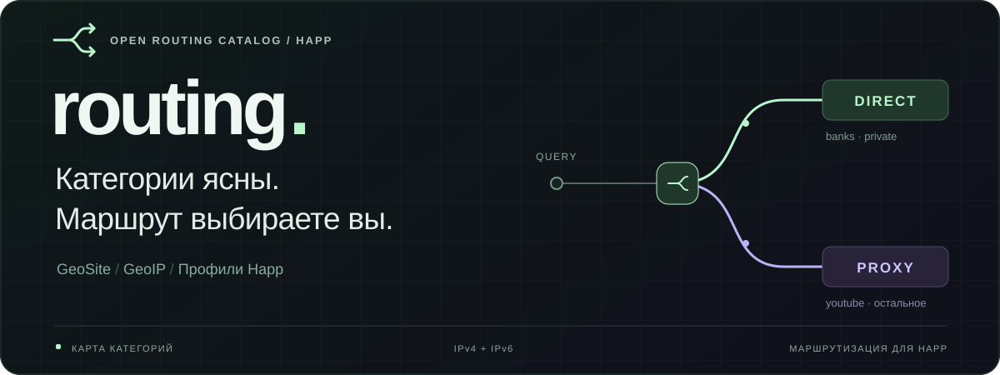
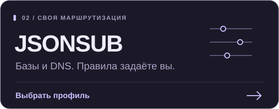

<p align="center">
  
</p>

<p align="center">
  Открытые списки доменов и IP-сетей.<br>
  Готовая маршрутизация или собственные правила — выбираете вы.
</p>

<p align="center">
  <a href="https://xaikq.github.io/routing/"></a>
</p>

<p align="center">
  <a href="geosite/"><b>Домены</b></a> &nbsp; / &nbsp;
  <a href="geoip/"><b>IP-сети</b></a> &nbsp; / &nbsp;
  <a href="happ/profiles.json"><b>Правила</b></a> &nbsp; / &nbsp;
  <a href="https://github.com/xAikq/routing/releases"><b>Релизы</b></a>
</p>

<br>

## Два способа начать

<p align="center">
  <a href="https://xaikq.github.io/routing/install/"></a>
  <a href="https://xaikq.github.io/routing/"></a>
</p>

**DEFAULT** направляет Яндекс, VK, Ozon, Wildberries, банки и локальные IP напрямую. YouTube и остальной трафик идут через прокси.

**JSONSUB** подключает наши базы и DNS. Списки правил пустые: назначьте категориям DIRECT, PROXY или BLOCK самостоятельно. До добавления исключений действует общий режим прокси.

Для подключения нужен настроенный VPN в Happ. После импорта дождитесь загрузки баз, выберите профиль и переподключитесь. Если браузер не открыл приложение, используйте кнопку на странице или импорт из буфера обмена.

<details>
<summary>Получить профиль файлом или скопировать ссылку</summary>

У каждого профиля два представления одной конфигурации:

- **JSON** — читаемые настройки, которые можно изучить и использовать в интеграции.
- **DEEPLINK** — те же настройки внутри ссылки `happ://routing/add/…`, готовой для импорта в Happ.

DEFAULT: [JSON](happ/generated/DEFAULT.JSON) · [ссылка импорта](happ/generated/DEFAULT.DEEPLINK)

JSONSUB: [JSON](happ/generated/JSONSUB.JSON) · [ссылка импорта](happ/generated/JSONSUB.DEEPLINK)

Для импорта из буфера скопируйте содержимое DEEPLINK-файла целиком. Быстрое подключение DEFAULT использует `onadd` и сразу активирует профиль; обычные ссылки `add` добавляют его в список.

JSONSUB — название профиля маршрутизации. В нём нет VPN-нод или ключей. Если провайдер использует JSON-подписку с ограничениями маршрутизации, отдельный ручной импорт может быть недоступен: [как это устроено в Happ](https://github.com/HappDev/happ_su/blob/main/dev-docs/routing.md).

</details>

> [!NOTE]
> **Стартовый набор.** Категории сервисов пока неполные. В `geoip:ru` добавлены только два адреса DNS Яндекса; для маршрутизации всей страны нужны дополнительные диапазоны.

<br>

## Из чего складывается маршрут

Каждая категория отвечает за содержимое списка. Действие для неё задаётся отдельно — в Happ или в готовом профиле.

```text
geosite:banks     → DIRECT
geosite:youtube   → PROXY
geoip:private     → DIRECT
```

Сейчас доступны:

- **Сервисы:** [yandex](geosite/yandex/), [vk](geosite/vk/), [ozon](geosite/ozon/), [wildberries](geosite/wildberries/), [youtube](geosite/youtube/).
- **Банки:** [sber](geosite/sber/) и объединяющая категория [banks](geosite/banks/).
- **Игры:** [riot](geosite/riot/) и объединяющая категория [games](geosite/games/). В Riot пока добавлен только `riotgames.com`.
- **IP-сети:** [private](geoip/private/) — частные сети, loopback и link-local IPv4/IPv6; [ru](geoip/ru/) — начальный пример с `77.88.8.8/32` и `77.88.8.1/32`.

Фактический состав опубликованных баз можно посмотреть в [categories.json](https://github.com/xAikq/routing/releases/latest/download/categories.json).

## Добавьте то, что нужно вам

Для существующего сервиса откройте его `.txt` и допишите домены. Для нового создайте папку с данными:

```text
geosite/my-service/domains.txt  → geosite:my-service
geoip/my-network/ipv4.txt       → geoip:my-network
```

Имя категории совпадает с именем папки. Используйте строчные латинские буквы, цифры, `_` и `-`. Категории располагаются непосредственно внутри `geosite/` и `geoip/`; вложенные категории пока не поддерживаются.

Чтобы объединить списки, перечислите их в файле агрегатора. Например, [banks/domains.txt](geosite/banks/domains.txt) включает Сбер:

```text
include:sber
```

Новая категория не включается в агрегатор автоматически. После добавления данных назначьте нужное действие в [happ/profiles.json](happ/profiles.json), если она должна участвовать в DEFAULT. Там же редактируются имена и описания профилей. JSONSUB сохраняет пустые списки правил.

<details>
<summary>Формат строк и ограничения</summary>

Доменные правила:

```text
# Комментарий отдельной строкой
domain:yandex.ru
full:passport.yandex.ru
regexp:^video[0-9]+\.yandex\.ru$
keyword:yandex
```

`domain:` охватывает домен и поддомены, `full:` — точное имя, `regexp:` — выражение Go/RE2, `keyword:` — подстроку. Без префикса используется `domain:`. IDN записывайте в punycode. Атрибуты `@...` и комментарии после правила не поддерживаются; пробел и `#` в regexp задавайте через `\x20` и `\x23`, в keyword они запрещены.

IP-правила записываются в CIDR, по одной сети на строку. Для одиночного IPv4 используйте `/32`, для IPv6 — `/128`. Адрес сети должен быть каноническим: `10.0.0.0/8`, а не `10.0.0.1/8`. IPv4-mapped IPv6 не поддерживается. В одной категории можно хранить несколько `.txt` с IPv4 и IPv6; `include:` работает и здесь.

Пустые категории, неизвестные включения и циклы запрещены. Пересекающиеся категории нельзя назначать разным действиям: например, `banks → DIRECT` конфликтует с `sber → PROXY`, если `banks` включает `sber`. Пересечения произвольных regexp/keyword проверяйте самостоятельно.

</details>

## Получайте обновления по тем же адресам

Исходные списки превращаются в новые базы при выпуске стабильного релиза. Адреса загрузки сохраняются:

**[geosite.dat](https://github.com/xAikq/routing/releases/latest/download/geosite.dat)** · **[geoip.dat](https://github.com/xAikq/routing/releases/latest/download/geoip.dat)** · [SHA256SUMS](https://github.com/xAikq/routing/releases/latest/download/SHA256SUMS)

Ссылки на файлы начинают работать после первого стабильного релиза. Загрузка обновлений в Happ зависит от кеша клиента и его ограничений частоты. Если изменились сами правила, повторно импортируйте свежий профиль: ранее скопированный диплинк содержит прежние настройки.

Импорт с тем же именем обновляет профиль. Если меняете правила вручную, сохраните собственную копию под другим именем. Готовые файлы в `happ/generated/` и страницы в `docs/` обновляются при публикации — для своих изменений используйте исходные списки и конфигурацию профилей.

---

Списки открыты для дополнений. При изменениях указывайте, к какому сервису относятся домены или сети. Условия использования — [MIT](LICENSE).
